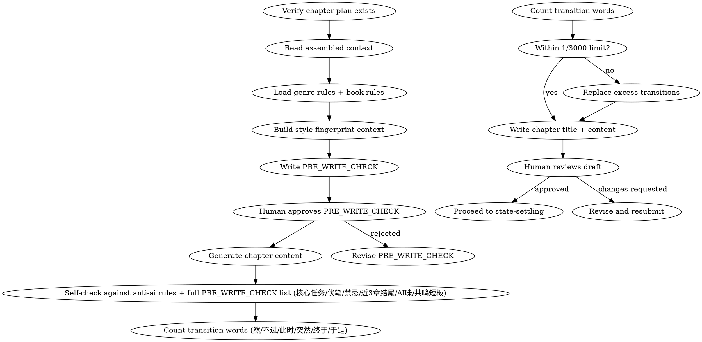

<!-- AUTO-CHECK-START -->

## auto-check (generated -- do not edit)

<!-- AUTO-CHECK-END -->

<!-- AUTO-GENERATED from frontmatter — do not edit -->

## 数据契约

- **Reads:** plans/chapter-N-plan.md, context/chapter-N-context.md, context/chapter-N-context-decisions.json, style/style_profile.md, genre-config.json, truth/audit_drift.md
- **Writes:** chapters/chapter-N.md, chapters/chapter-N-decisions.json
- **Updates:** none

<!-- END AUTO-GENERATED -->

# 章节起草

HARD-GATE: 不得在没有章节备忘的情况下起草正文。

> **Pipeline 集成**: 当由 pipeline 编排时,`context/chapter-N-context.md` 由 `pipeline-context-assemble` 预先组装 (三路检索 + 重排)。本 skill 直接读取此文件作为主上下文输入,不再自行从 truth files 加载。

## 流程



## 铁律

1. **NO CHAPTER WITHOUT A PLAN** — 没有章节备忘（`plans/chapter-N-plan.md`）就动笔 = 删除重来
2. **PRE_WRITE_CHECK 必写** — 起草前列出：本章核心任务、使用的伏笔、要避免的错误。PRE_WRITE_CHECK 必须作为章节文件的第一个区块输出，位于正文之前，人类批准后才写正文
3. **叙述者不替读者下结论** — 严禁"让人...感悟"、"引人...深思"类反思句
4. **正文严禁分析报告式语言** — 不出现 hook_id、账本数据、元叙事
5. **转折词密度 ≤ 1/3000字** — 然/不过/此时/突然/终于/于是
6. **参考 anti-ai-reference.md** — 所有 AI 味检查清单在 `anti-ai-reference.md`
7. **篇幅契约** — 目标字数 = `genre-config.json` 的 `chapter_word.default`（计划「目标字数」行同源）。G4 度量口径：正文**去空白字符数**（含标点、剥 META 块）——写作时的「感觉字数」普遍比该口径虚高 15-25%，必须按场景预算铺量：起草前把目标字数分解为场景字数预算（合计 ≥ 目标），不足时在既有场景内扩感官细节、对白往返与动作过程，不新增场景、不注水重复；POST 自检的字数必须**逐段计数合计**——按场景逐段点出每段去空白字符数，段内相加、场景相加得出总计，禁止整段估数（整段估数普遍虚高 15-25%）

## 写作自检表 (PRE_WRITE_CHECK)

起草前完成以下自检：

```
PRE_WRITE_CHECK:
- 本章核心任务: [从备忘第1段]
- 要兑现的伏笔: [从备忘第3段]
- 本章禁忌: [从备忘第8段]
- 近3章结尾方式: [避免重复]
- AI味重点防范: [根据最近的 audit_drift]
- 共鸣短板（读 truth/audit_drift）: [本章重点防范的体验轴短板]
```

## 创作原则

1. **场景驱动而非叙述驱动** — 用动作和对话推进，不是内心独白
2. **Show don't tell** — 情绪用行为表现，不直接说"他感到愤怒"
3. **80/20 断章** — 章尾 20% 必须重新点燃好奇心
4. **段落呼吸** — 长短交替，不让视觉节奏单调
5. **对话指纹** — 角色说话必须匹配 voice_profile

## 输出格式

写 `chapters/chapter-N.md`：

```markdown
<!--META-BEGIN-->
## PRE_WRITE_CHECK

- 本章核心任务: [从备忘第1段]
- 要兑现的伏笔: [从备忘第3段]
- 本章禁忌: [从备忘第8段]
- 近3章结尾方式: [避免重复]
- AI味重点防范: [根据最近的 audit_drift]
- 共鸣短板（读 truth/audit_drift）: [本章重点防范的体验轴短板]
- 转折词预算: ≤ [字数/3000] 个
- 场景字数预算: [场景1 ~N字 / 场景2 ~N字 / …；合计 M 字 ≥ genre-config chapter_word.default]
<!--META-END-->

# 章节标题

[正文内容]

<!--META-BEGIN-->
## POST_WRITE_SELF_CHECK

- [ ] 转折词密度: X / Y字 = Z (≤ 1/3000)
- [ ] 章尾好奇心点燃: [是/否]
- [ ] 无反思句/元叙事: [是/否]
- [ ] 正文字数（逐段计数合计）: [场景1: 15+12+8+…=S1；场景2: 10+9+…=S2；…；总计 S1+S2+…=N]（逐段点数每段去空白字符数、含标点、剥本 META 块，段内相加再跨场景相加；禁止整段估数；N < 目标字数即不合格——先在既有场景内补足再输出）
<!--META-END-->
```

章节标题不要包含章节号（如"第一章"），文件名已编码章节号。

## 元数据与正文分离（新增铁律）

> **WARNING: META blocks are NOT part of the novel prose.**
>
> META blocks (`<!--META-BEGIN-->...<!--META-END-->`) contain internal
> quality-control self-checks (PRE_WRITE_CHECK and POST_WRITE_SELF_CHECK).
> These are for pipeline use only. Downstream parsers (word count, audit,
> scoring, publication) MUST strip META blocks before processing prose.
> The canonical stripping method is in `src/shenbi/gates/shared.py:120-121`.
> See `docs/framework/chapter-file-format.md` for full specification.

## Anti-Rationalization

| Excuse | Reality |
|--------|---------|
| "这章太简单了，不需要自检" | 越简单的章越容易暴露 AI 味 |
| "PRE_WRITE_CHECK 浪费时间" | 5分钟自检省30分钟返工 |
| "AI味读者看不出来" | 平台检测算法看得很清楚 |
| "先写完再检查" | 写完再改 = 重写。边写边注意 = 一次过 |

## decisions sidecar 必填字段

每次执行后**必须写出** `chapters/chapter-N-decisions.json`（decisions sidecar，schema `shenbi-decisions-v1`）。**该文件的 ### FILE 块内容必须是纯 JSON（块内首字符即 `{`，禁止 markdown 标题与围栏代码块）；`### FILE:` 标记行本身照常输出，且不得以「纯 JSON」为由省略章节文件块。** 必填字段：
- `$schema`: `shenbi-decisions-v1`（固定值）
- `skill`: 本技能名
- `chapter`: 章节号（非章节产物用 `null`）
- `produced_at`: ISO-8601 时间戳
- `selections`/`adjustments` 遵循 P2.5：medium/high severity、manual_override、adjustments 必附 ≤100 字 `rationale`；routine+low 禁附

**字段级规格（G4 逐项强校验，形态错误即闸门失败）**：
- `selections[]`: `target`（**str，必填**，被选取的文件路径——路径放这里，不放 selected）、`selected`（**list[str]**，条目名列表——禁止写成字符串）、`basis`（**仅限四枚举之一**：`adjacent_to_target_chapter` / `arc_relevance` / `volume_scope` / `manual_override`——禁止自造值）、`severity`（`low`/`medium`/`high`）、`omitted`（list[str]）
- `adjustments[]`: `issue_id`（str，必填）、`severity`、`handling`（**仅限四枚举之一**：`compensate_via_pacing` / `explicit_callout` / `defer_to_next_chapter` / `ignore`——禁止自造值）、`rationale`（必填，≤100 字）

**可仿写示例**：

```json
{
  "$schema": "shenbi-decisions-v1",
  "skill": "shenbi-chapter-drafting",
  "chapter": 1,
  "produced_at": "2026-09-28T12:00:00Z",
  "selections": [
    {
      "target": "plans/chapter-1-plan.md",
      "selected": ["scene-1", "hook-open"],
      "basis": "adjacent_to_target_chapter",
      "severity": "low",
      "omitted": []
    }
  ],
  "adjustments": []
}
```
