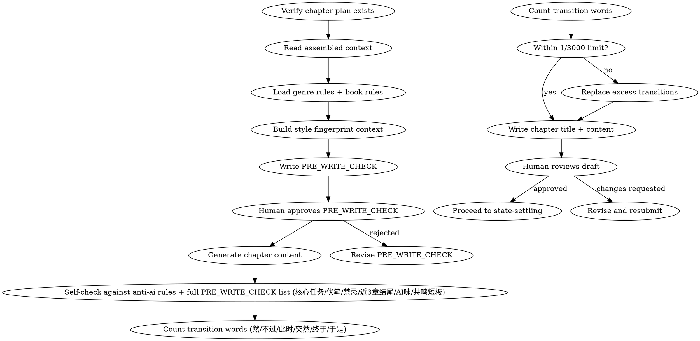

<!-- AUTO-CHECK-START -->

## auto-check (generated -- do not edit)

<!-- AUTO-CHECK-END -->

<!-- AUTO-GENERATED from frontmatter — do not edit -->

## 数据契约

- **Reads:** plans/chapter-N-plan.md, context/chapter-N-context.md, context/chapter-N-context-decisions.json, style/style_profile.md, style/style_directives.md, style/anchors.md, genre-config.json, truth/audit_drift.md
- **Writes:** staging/chapter-N-bundle.md, chapters/chapter-N-decisions.json, chapters/chapter-{N+1}-decisions.json
- **Updates:** none

<!-- END AUTO-GENERATED -->

## 场景簇产物协议（spec #72 粒度契约）

一次派发 = 连续 2 章（约 6400 字；卷末单章簇退化为 1 章）。产物形态：

- **staging 簇产物** `staging/chapter-N-bundle.md`：每章一段完整现行章结构——
  `===CH:n===` 行起章（章界标记，拆分后剥离）、`## PRE_WRITE_CHECK` 块、
  **双 H1（其二为章题）**、正文、`## POST_WRITE_SELF_CHECK` 块
- **SCENE 标记**：`<!--SCENE-->` 独占一行置于每场景开头（耐久标记——终稿保留，
  发布层剥离；计数面自动豁免）
- **每场景末行 = 备忘声明的收束钩原文逐字落款**（G4 声明-实际精确匹配：
  声明文本剥空白须为场景末非空行子串）
- 每章末尾必须落在备忘声明的章尾钩上；正文中的时间表述与备忘「时间锚」声明同口径（#75 跨章门消费）
- 两份章级 decisions sidecar（章 1 与章 2 各一）照常产出
- 拆分器（pipeline-scene-split 步）将按 CH 标记拆章并逐章校验：字数带
  2800-4000（total_chars 口径）、场景数 ≥2、每场景字数落两型域——灰域即熔断重派

# 章节起草

HARD-GATE: 不得在没有章节备忘的情况下起草正文。

> **Pipeline 集成**: 当由 pipeline 编排时,`context/chapter-N-context.md` 由 `pipeline-context-assemble` 预先组装 (三路检索 + 重排)。本 skill 直接读取此文件作为主上下文输入,不再自行从 truth files 加载。

## 流程



## 铁律

1. **NO CHAPTER WITHOUT A PLAN** — 没有章节备忘（`plans/chapter-N-plan.md`）就动笔 = 删除重来
2. **PRE_WRITE_CHECK 必写** — 起草前列出：本章核心任务、使用的伏笔、要避免的错误。PRE_WRITE_CHECK 必须作为章节文件的第一个区块输出，位于正文之前，人类批准后才写正文
3. **叙述者不替读者下结论** — 严禁"让人...感悟"、"引人...深思"类反思句
4. **正文严禁分析报告式语言** — 不出现 hook_id、账本数据、元叙事
5. **转折词密度 ≤ 1/3000字** — 然/不过/此时/突然/终于/于是
6. **参考 anti-ai-reference.md** — 所有 AI 味检查清单在 `anti-ai-reference.md`
7. **篇幅契约** — 目标字数 = `genre-config.json` 的 `chapter_word.default`（计划「目标字数」行同源）。G4 度量口径：正文**去空白字符数**（含标点、剥 META 块）——写作时的「感觉字数」普遍比该口径虚高 15-25%，必须按场景预算铺量：起草前把目标字数分解为场景字数预算（合计 ≥ 目标），不足时在既有场景内扩感官细节、对白往返与动作过程，不新增场景、不注水重复；POST 自检的字数必须**逐段计数合计**——按场景逐段点出每段去空白字符数，段内相加、场景相加得出总计，禁止整段估数（整段估数普遍虚高 15-25%）

## 写作自检表 (PRE_WRITE_CHECK)

起草前完成以下自检：

```
PRE_WRITE_CHECK:
- 本章核心任务: [从备忘第1段]
- 要兑现的伏笔: [从备忘第3段]
- 本章禁忌: [从备忘第8段]
- 近3章结尾方式: [避免重复]
- 章尾张力拍（从备忘段6「章尾张力拍」行）: [未答之问/未说破之瞒/未合拢之缝 + 指向对象]
- AI味重点防范: [根据最近的 audit_drift]
- 共鸣短板（读 truth/audit_drift）: [本章重点防范的体验轴短板]
- payoff 拍（从备忘段1）: [类型｜强度——正文按此兑现；「无」则本章纯蓄压]
- 主导情绪（emotion_tone，从备忘段1）: [悲/喜/怒/惧/平]
- 感官锚: [本章主导感官通道 + 一个可回味的物象]
- 本章母题物象: [卷纲物象 + 本章变奏]（从备忘段 1 读）
- 本章金句位: [对比/反差/口诀化｜落点场景]（从备忘段 1 读）
```

## 创作原则

1. **场景驱动而非叙述驱动** — 用动作和对话推进，不是内心独白
2. **Show don't tell** — 情绪用行为表现，不直接说"他感到愤怒"
3. **80/20 断章** — 章尾 20% 必须重新点燃好奇心。**两条独立约束，满足前者不得抵消后者**（裁决 199 实证：为避同型结尾而改用动作/意象收束时，硬标记一并被丢）：
   - **收束方式须变化**：勿连续以同型结尾收束（对照 PRE_WRITE_CHECK「近3章结尾方式」）——动作/意象收束是被鼓励的变化方向；
   - **章尾张力硬标记（G4.cd 硬闸口径）**：正文末 8 个叙述段的合并窗口（≥30 汉字即检查）必须至少含一处字面疑问号（？/?）、张力词（但/然而/却/不过/还/仍/依然/尚未/未解/不知/等待/没说/没答/瞒/藏/账/欠/谜/未完/代价）或账目行（窗口内 ≥2 处阿拉伯数字的冷数字收尾——账目钩的合法形态）。无论收束拍是问句、动作还是意象，张力必须织进末 8 段本身，不得只落在窗口之外。
4. **段落呼吸** — 长短交替，不让视觉节奏单调。**段落质量下限（G4.cd 视觉场景硬闸口径，裁决 371/375 实证两章 3 试被闸）**：微段是风格，但正文必须存在成段段落——任意连续 8 个叙述段合计峰值须 ≥100 汉字且其中带对白/动作的段 ≥4（按 style_profile 段落基线段均 ≈16 字成段，对白并为「引语＋归属＋动作拍」）；「以可见物象替代独白」不等于一句一顿、一顿一行的极限断行（ch114 实测 190 段中位 6 字、峰值 70，全窗口死闸）
**声口与金句强制段（#76，v2 备忘章）**：①备忘「声口要求」行是本章主角声口的硬预算——口癖串、账房腔句式、自嘲式反问收尾须在正文中兑现（G4.cd 密度检查对照 genre-config `voice_density_min.min_per_chapter`，不足 = FAIL）；②备忘「金句位」行的静/燃类型照抄进 PRE_WRITE_CHECK 的「本章金句位」行与章尾钩行的「[?] 金句位」行——**三点同型**（静/燃 前缀一致），缺型或异型 = FAIL。

5. **对话指纹** — 角色说话必须匹配 voice_profile；关键对白三层结构：信息／关系变化／潜台词至少推进其一（潜台词三法：答非所问／一语双关／反话克制）
6. **文风目标带（style_directives）** — 若 `style/style_directives.md` 存在（用户手写的总体文风目标，标准结构与示例见 `docs/framework/style-directives.md`），其句长目标带/节奏/意象密度/对白叙述比等**目标**优先于 style_profile 的统计**现状**（profile 回答「现在是什么」，directives 设定「要什么」——没有 directives 时才以 profile 为参照）。**硬闸不因 directives 松动**：转折词密度、AI 标记词、fatigueWords、字数契约、段落下限一律照常执行。文件缺席 = 本条不适用，照旧按 profile 写。
7. **章型调制（自动，无需人工逐章设定）** — 全局目标带是基带，本章章型在带内调制。调制键 = 备忘段 1 的 `chapter_role`（主）与 `chapter_type`（次，选填）：
   - `chapter_role: 高潮/兑现` → 句长压向带下沿、动作动词密度上调、段落更碎（仍守 8 段下限）；高潮 = 斩截与咏叹交替——短句连排后允许 1-2 句 ≥35 字咏叹长句（反向档）
   - `chapter_role: 推进/转折` → 带中位节奏，转折信息落在对白缝隙与物象变化
   - `chapter_role: 过渡/铺垫` → 句长浮向带上沿、感官意象密度上调、对白占比压向带下沿——过渡章是长句与意象的合法栖息地
   - `chapter_type` 叠加内容向调制：battle=动觉/听觉意象优先；dialogue=对白占比浮向带上沿、归属动作拍全守；political_intrigue=静物/空间意象、信息藏于留白；training=过程细节密度上调；memorial=铭记章专用档：单场景纯度、五感密度顶格、对白占比压向下沿、禁蒙太奇与多线并置、章末固定信物钩（遗物入匣拍）
   - 调制永远在 style_directives 的带内移动（带是用户目标，调制是带内重心）；五道硬闸（转折词/AI 标记词/fatigueWords/字数/段落下限）不因调制松动
8. **感官拍（氛围的地基）** — 每个场景至少两个感官通道（视觉之外至少一项：听觉/触觉/嗅觉/味觉/体感）。章型调制即感官配额：battle=动觉/听觉、dialogue=声调与停顿、political_intrigue=空间与静物、training=触觉与疲劳感、过渡/铺垫=长句与意象密度。PRE_WRITE_CHECK 的「感官锚」行须点名本章主导通道与一个可回味的物象——氛围（《炮火弧线》自述第一卖点）不靠事后返修补，起草时就铺。
9. **微粒钩** — 与审计面的牵引点分工：牵引点（冲突/揭示/转折，group-craft 审计口径每 800-1200 字一个）是底账；微粒钩是其中悬念/爽点/情感类的强化拍，每 2500-3500 字保一枚，场景字数预算行同步标注每场景的钩位；发布若按双更切分（约 3500 字/更），切分点选场景边界并给上半段补一枚中钩——章末钩审计按整章口径，切分后钩位须重排。
10. **落差工艺** — 长句蓄势短句收割；三叠句刀刃使用（高潮/悲拍每章 ≤1 处）；点染收尾——章尾情绪落物象不落陈述。

## 输出格式

写 `chapters/chapter-N.md`：

```markdown
<!--META-BEGIN-->
## PRE_WRITE_CHECK

- 本章核心任务: [从备忘第1段]
- 要兑现的伏笔: [从备忘第3段]
- 本章禁忌: [从备忘第8段]
- 近3章结尾方式: [避免重复]
- 章尾张力拍（从备忘段6「章尾张力拍」行）: [未答之问/未说破之瞒/未合拢之缝 + 指向对象]
- AI味重点防范: [根据最近的 audit_drift]
- 共鸣短板（读 truth/audit_drift）: [本章重点防范的体验轴短板]
- payoff 拍（从备忘段1）: [类型｜强度——正文按此兑现；「无」则本章纯蓄压]
- 主导情绪（emotion_tone，从备忘段1）: [悲/喜/怒/惧/平]
- 感官锚: [本章主导感官通道 + 一个可回味的物象]
- 本章母题物象: [卷纲物象 + 本章变奏]（从备忘段 1 读）
- 本章金句位: [对比/反差/口诀化｜落点场景]（从备忘段 1 读）
- 转折词预算: ≤ [字数/3000] 个
- 场景字数预算: [场景1 ~N字（微粒钩：类型+一句指认） / 场景2 ~N字（钩：…） / …；合计 M 字 ≥ genre-config chapter_word.default]
<!--META-END-->

# 章节标题

[正文内容]

<!--META-BEGIN-->
## POST_WRITE_SELF_CHECK

- [ ] 转折词密度: X / Y字 = Z (≤ 1/3000)
- [ ] 成段窗口（G4.cd 视觉场景口径）: 任意连续 8 叙述段合计峰值 = [数字] 汉字（须 ≥100 且带对白/动作段 ≥4；不足 = 先合并断行再输出，勿以极限断行替代画面）
- [ ] 章尾张力（G4.cd 口径）: 末 8 叙述段合并窗口命中原句 = [摘录原句]（须含字面 ？/?、张力词 但/然而/却/不过/还/仍/依然/尚未/未解/不知/等待/没说/没答/瞒/藏/账/欠/谜/未完/代价 之一，或 ≥2 处阿拉伯数字的账目行；摘不出原句 = 未达标，先改收束拍再输出，勿以「已点燃」自述代替）
- [ ] 无反思句/元叙事: [是/否]
- [ ] 正文字数（逐段计数合计）: [场景1: 15+12+8+…=S1；场景2: 10+9+…=S2；…；总计 S1+S2+…=N]（逐段点数每段去空白字符数、含标点、剥本 META 块，段内相加再跨场景相加；禁止整段估数；N < 目标字数即不合格——先在既有场景内补足再输出）
- [ ] 微粒钩: 每场景一枚强化拍已落位 = [场景1: 钩句摘录 / 场景2: …]（底账口径牵引点每 800-1200 字见 group-craft；超 3500 字的场景补第二枚）
- [ ] 奔涌句: 每场景 ≥1 句 ≥35 字 = [场景1: 原句摘录 / 场景2: …]（摘不出原句 = 未达标，先补奔涌再输出）
- [ ] 金句位: [静/燃｜写法｜落点]＝[原句摘录]（三点同型打头——与备忘段 1 金句位行同值，#78 三点同步；原句随后；摘不出原句 = 未达标，先补金句再输出）
<!--META-END-->
```

章节标题不要包含章节号（如"第一章"），文件名已编码章节号。

## 元数据与正文分离（新增铁律）

> **WARNING: META blocks are NOT part of the novel prose.**
>
> META blocks (`<!--META-BEGIN-->...<!--META-END-->`) contain internal
> quality-control self-checks (PRE_WRITE_CHECK and POST_WRITE_SELF_CHECK).
> These are for pipeline use only. Downstream parsers (word count, audit,
> scoring, publication) MUST strip META blocks before processing prose.
> The canonical stripping method is in `src/shenbi/gates/shared.py:120-121`.
> See `docs/framework/chapter-file-format.md` for full specification.

## Anti-Rationalization

| Excuse | Reality |
|--------|---------|
| "这章太简单了，不需要自检" | 越简单的章越容易暴露 AI 味 |
| "PRE_WRITE_CHECK 浪费时间" | 5分钟自检省30分钟返工 |
| "AI味读者看不出来" | 平台检测算法看得很清楚 |
| "先写完再检查" | 写完再改 = 重写。边写边注意 = 一次过 |

## decisions sidecar 必填字段

每次执行后**必须写出** `chapters/chapter-N-decisions.json`（decisions sidecar，schema `shenbi-decisions-v1`）。**该文件的 ### FILE 块内容必须是纯 JSON（块内首字符即 `{`，禁止 markdown 标题与围栏代码块）；`### FILE:` 标记行本身照常输出，且不得以「纯 JSON」为由省略章节文件块。** 必填字段：
- `$schema`: `shenbi-decisions-v1`（固定值）
- `skill`: 本技能名
- `chapter`: 章节号（非章节产物用 `null`）
- `produced_at`: ISO-8601 时间戳
- `selections`/`adjustments` 遵循 P2.5：medium/high severity、manual_override、adjustments 必附 ≤100 字 `rationale`；routine+low 禁附
**P2.5 二分支自查（写每条 selection 前过一遍，G4 逐项强校验）**：
- 常规取舍 → `"severity": "low"` 且**不写** rationale 键；
- 有实重取舍（驱动 adjustments／响应漂移滑点／卷级口径裁剪）→ `"severity": "medium"` + **必写** ≤100 字 rationale（说清取了什么、为何这个分量）；
- 两种禁组（各实证 3 试被闸）：`low`+rationale、`medium`+无 rationale；rationale **写完数字数 ≤90 字留余量**（Python len 计、中文每字 1 含标点——ch92 实证贴边计数失误 3 试被闸）。
- **组合陷阱（vol1 ch1/ch6 escalation 实证，7 次/6 章）**：`basis: manual_override` **不论 severity 都必带 rationale**——「低危常规圈选但人工指定」也是 manual_override。最常见漏写形态：style 圈选（style_directives/style_profile）写 `manual_override`+`low`+无 rationale。写法：一句话说明为何手工圈选这几段（≤90 字），severity 保持 low 不变。

**字段级规格（G4 逐项强校验，形态错误即闸门失败）**：
- `selections[]`: `target`（**str，必填**，被选取的文件路径——路径放这里，不放 selected）、`selected`（**list[str]**，条目名列表——禁止写成字符串）、`basis`（**仅限四枚举之一**：`adjacent_to_target_chapter` / `arc_relevance` / `volume_scope` / `manual_override`——禁止自造值）、`severity`（`low`/`medium`/`high`）、`omitted`（list[str]）
- `adjustments[]`: `issue_id`（str，必填）、`severity`、`handling`（**仅限四枚举之一**：`compensate_via_pacing` / `explicit_callout` / `defer_to_next_chapter` / `ignore`——禁止自造值）、`rationale`（必填，≤100 字）

**可仿写示例**：

```json
{
  "$schema": "shenbi-decisions-v1",
  "skill": "shenbi-chapter-drafting",
  "chapter": 1,
  "produced_at": "2026-09-28T12:00:00Z",
  "selections": [
    {
      "target": "plans/chapter-1-plan.md",
      "selected": ["scene-1", "hook-open"],
      "basis": "adjacent_to_target_chapter",
      "severity": "low",
      "omitted": []
    }
  ],
  "adjustments": []
}
```
