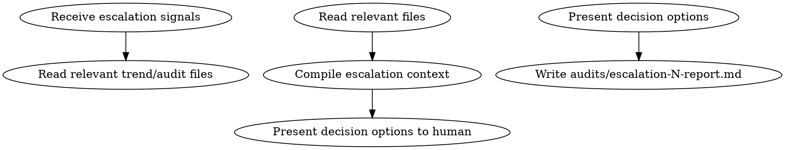

<!-- AUTO-CHECK-START -->

## auto-check (generated -- do not edit)

<!-- AUTO-CHECK-END -->

<!-- AUTO-GENERATED from frontmatter — do not edit -->

## 数据契约

- **Reads:** truth/resonance_trend.md, audits/chapter-N-sensitivity.md, truth/volume_score_trend.md, truth/arc_payoff_trend.md, audits/stratum-*-score.md
- **Writes:** audits/escalation-N-report.md
- **Updates:** none

<!-- END AUTO-GENERATED -->

# 人工升级审查

仅在 `run_escalation_check`（`src/shenbi/orchestration/escalation_bridge.py`）返回非空信号时触发。汇总升级原因 + 相关评分数据，呈交人工决策。

## 流程



## 铁律

1. **只读不评** — 不产生评分，只汇总升级上下文供人工决策
2. **决策选项明确** — 每个升级给出 2-3 个具体选项

## Anti-Rationalization

| Excuse | Reality |
|--------|---------|
| "信号只是轻微超标，自动处理掉就行" | 升级信号 = 触发条件已满足。绕过人工审查 = 破坏升级桥契约 |
| "数据不全，先凭已有部分下结论" | 只读不评。你的职责是完整汇总上下文，决策权在人类伙伴 |
| "趋势文件看起来正常，不用读了" | 不读全 reads 清单 = 汇总缺角 = 人类基于残缺信息决策 |
| "报告里顺便给个建议评分" | 本技能不产生评分。评分归属 score-* 技能，越界 = 契约违规 |
| "决策选项太麻烦，列一个就行" | 每个升级必须给出 2-3 个具体选项。单一选项 = 伪决策 |

## 输出格式

```markdown
## 升级审查报告

**触发信号**: [signal type]
**触发时间**: YYYY-MM-DD
**相关章节/卷/弧**: N

### 升级上下文
[触发条件的完整数据]

reads 表规则：若派发输入含「FAILING SKILL CONTRACT READS（machine-provided）」清单，升级上下文的 reads/输入可用性表**必须**逐条渲染该清单（含 AVAILABLE/MISSING 状态），**不得**罗列本报告技能自己的 reads——汇总的是失败技能的上下文，不是你自己的（probe2 2026-10-01：两份 genesis 升级报告都列成了本技能的趋势文件清单，全部 N/A，裁决人被迫手工纠偏）。

失败特征归类规则：判定「前置输入缺失/依赖类」前，必须先核对派发侧机器证据——若失败技能的实际派发 prompt_tokens 非零（输入已注入）且存在 output_quarantined / no_files_parsed / length_truncation 记录，则失败在**输出侧**（格式/容量），reads 表的 MISSING 不得作为根因（probe14 step 12：glob 形态 reads 被显示层标 MISSING，报告据此误判「前置输入缺失」，三个正面选项全部建立在错误分类上）。reads 表中标「本技能产物（派发前不存在属预期）」或「AVAILABLE (glob-expanded)」的条目，一律不得计入输入缺失。

### 决策选项
（选项必须匹配失败类别——不得照抄示例清单：容量类失败给容量类选项，内容类失败给修订类选项）
1. 接受现状，继续自动批
2. 回滚到第N章快照，手动修订
3. 手动修订当前产出
4. 输出容量类（completion tokens 顶格 / length_truncation / 单次多文件超限）：
   提高该技能的 executor 输出上限（executor_config.toml overrides，参考
   faction-builder/state-settling 的 49152 先例）或拆分派发后重跑
```
