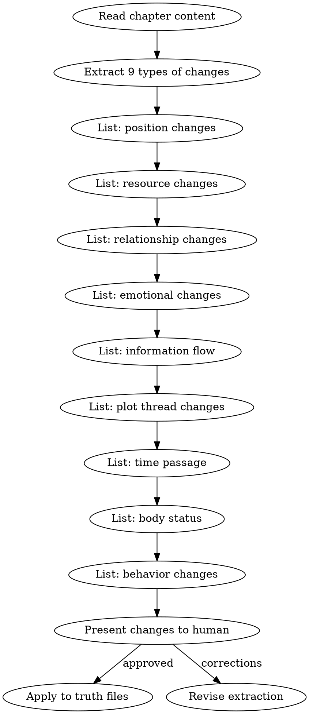

<!-- AUTO-CHECK-START -->

## auto-check (generated -- do not edit)

<!-- AUTO-CHECK-END -->

<!-- AUTO-GENERATED from frontmatter — do not edit -->

## 数据契约

- **Reads:** chapters/chapter-N.md, chapters/chapter-{N+1}.md, truth/character_matrix.md, truth/current_state.md, truth/particle_ledger.md, truth/emotional_arcs.md, truth/subplot_board.md, truth/pending_hooks.md, truth/chapter_summaries.md, truth/volume_summaries.md, audits/chapter-N-foreshadowing.md, truth/timeline.md, truth/prop_registry.md, truth/name_registry.md, truth/recall_registry.md
- **Writes:** truth/state-settling-decisions.json
- **Updates:** truth/current_state.md, truth/particle_ledger.md, truth/emotional_arcs.md, truth/subplot_board.md, truth/pending_hooks.md, truth/chapter_summaries.md, truth/character_matrix.md, truth/timeline.md, truth/prop_registry.md, truth/name_registry.md, truth/recall_registry.md

<!-- END AUTO-GENERATED -->

# 状态结算

HARD-GATE: 状态结算在每章起草后**必须执行**。跳过 state-settling 的章节视为未完成——后续章节的 chapter-planning 读到的 truth files 是过时的，导致全书状态漂移。

**#72 双章束规则**：当 reads 含 `chapters/chapter-{N+1}.md`（bundle 派发，leader 章结算连带 follower 章）时，本次输出必须同时覆盖两章——current_state／timeline／chapter_summaries 的 append_dedup 各出**两行**（N 与 N+1 各一行），character_matrix 出**两个**「## 第N章状态增量」块，follower 章的新角色／新物件照登 name_registry／prop_registry。漏 follower 章增量 = 后续 planning 读到过时真相（regen v3 ch2-12 六次实证，全部手工补合）。

### 铁律 0：所有 update 文件 ABSOLUTELY NEVER modify 现有行（Batch #22 强化）

**对 `truth/character_matrix.md` 等全部 `mode: append_dedup` 目标文件**：

1. **ABSOLUTELY NEVER modify 现有 rows**——任何对已有「## 第N章状态增量」section 或「交互总表」已有行的文本重写（如扩展 `- 当前位置: ...` 内容、合并活跃关系等），都触发 G4.ss.matrix_structure content_dropped（attempts=3 耗尽后 approve 仍失败，详见 probe29 ch4）。
2. **append-only 输出**：本 chapter 的增量必须以全新 `## 第N章状态增量` 块的形式插入（或对应 append_dedup 键的全新 row），**绝不要 touch 任何之前的 section 或 row**。
3. **若需更新已有行**——重写整个 chapter 状态块到对应新 chapter 块，旧块保留原样（这是 append_dedup 的 key-merge 语义；旧 chapter 不被覆盖）。
4. **live 文件的当前内容已在你的 reads 里**——你的任务只发增量，不发「live 现状的副本 + 你的改动」。

违反铁律 0 = G4.ss.matrix_structure FAIL + state-settling attempts=3 耗尽 → 章节卡死。**本铁律自 probe29 ch4 验证后固化（sessions 23-24）。**

### Truth File Update Mode Rules (CRITICAL)

**All ten `updates:` targets in this skill's contract are declared `mode: append_dedup` — the pipeline's dispatch write path merges your output into those files BY KEY. You must NEVER output the whole file content for them.**

- **append_dedup files** (cumulative — output ONLY the current chapter's row(s), NEVER the entire file):
  - `truth/current_state.md` — one row for the current chapter's snapshot (key: `chapter`)
  - `truth/particle_ledger.md` — one row PER 变动项 for the current chapter (composite key: `章节,变动项` — a chapter may legitimately carry several rows; never merge them into one)
  - `truth/emotional_arcs.md` — one row PER 角色 whose arc progresses this chapter (composite key: `章节,角色` — several arcs may legitimately advance in one chapter; never merge them into one)
  - `truth/subplot_board.md` — one row PER 支线 touched this chapter (composite key: `章节,支线` — several subplots may advance in one chapter)
  - `truth/chapter_summaries.md` — one row summarizing the current chapter (key: `chapter`)
  - `truth/pending_hooks.md` — per-hook FIELD updates as colon bullets under the hook's own heading (key: `hook_id`) — see "pending_hooks 增量格式" below

- **append_dedup files（#75 registry 三表——跨章不变量的滚动数据源）**:
  - `truth/timeline.md` — one row PER 本章时间锚点 for the current chapter: `| 第 N 章 | <本章末锚，如 腊月初十> | <备注> |` (key: `章` — first cell carries the chapter number like the other chapter-keyed tables). Narrative dates ONLY (叙事锚); do NOT log in-text book/citation dates. G4.xc compares this row against the previous chapter's row for monotonicity.
  - `truth/prop_registry.md` — one row PER 经手/初见 物象 this chapter: `| <实体名> | <当前 owner> | <事件，如 萤→临> |` (key: `实体名` — re-emitting an existing entity's row UPDATES its owner; that is the owner-chain). Known motif props appearing WITHOUT a row here trip invariant 4 (`物象出现但无经手声明`).
  - `truth/name_registry.md` — one row PER changed/added 称谓 entry: same 3-column layout as the seeded table `| 类别 | 名 | 备注 |` (key: `类别` — 登记名/代词白名单/禁用名 rows upsert in place). Only emit rows that actually changed; omit untouched rows.

- **append_dedup file（#78 死者回触登记）**:
  - `truth/recall_registry.md` — output ONLY rows for dead characters receiving a low-cost recall touch this chapter (物象/小调/台词任一形态命中): re-emit that character's full row `| 死者名 | 死亡章 | 权重 | 化名 | 末触章=本章 |` (key: `死者名` — the row upserts 末触章 in place). No touch this chapter → emit nothing for that character.

**WARN 接线（#75）**：G4.xc 的 registry 缺席 / prev 缺档 / 相对锚 WARN 走 structlog 并随 gate 结果进 manifest checks；每次 settle 读上一章 gate 结果中的 XC WARN，若在场则在本章 `truth/audit_drift.md` 增量里记一条（口径：`[跨章] XC.<id> 持续在场——registry 层降级`），供下章 PRE_WRITE_CHECK 与卷末结算看见。

- **append_dedup file（增量合并，复合键）**:
  - `truth/character_matrix.md` — output ONLY the current chapter's increment: (a) changed rows of the 交互总表 (key: `角色A,角色B` composite — a row per pair that actually interacted this chapter, same column layout as the live table) and (b) one `## 第N章状态增量` section block (heading + its rows/prose). NEVER reproduce the whole file, other chapters' rows, the 信任度初值 sections, or the frontmatter — the pipeline merges your increment against the live base by key and G4 verifies base preservation (probe2 2026-10-01: the whole-file rewrite contract made settle output grow O(chapters) and blow the model output cap — two settles silently dropped base mass to fit). The increment section is ONE atomic `##` block carrying all its `###` subsections — the protagonist's current state lives ONLY inside this chapter's block (probe6 ch2: folding the protagonist's updated state into a previous chapter's subsection, retitling/absorbing history sections, or replacing old interaction rows are all restructure damage — G4 rejects them; append, never replace).

**Row format:** a markdown table row whose FIRST cell is the chapter key (`第N章` or `N`), e.g. `| 第 5 章 | 主角进入内门；灵石 -20；线索：考核完成 |`. The pipeline's `write_truth_file()` merges by that key cell — re-running the same chapter replaces that chapter's row only (re-runs are safe), and rows for other chapters are preserved. Do NOT reproduce other chapters' rows in your output, and do NOT output headings/frontmatter for append_dedup files — output only the new row(s). `pending_hooks.md` does NOT use table rows in your output — use the per-hook bullet format below.

**各表行形态（表头由程序在首写时引导，列序必须照此）**：

| 目标 | 列序（第一列=章节键） |
|------|----------------------|
| `truth/current_state.md` | 章节｜位置｜时间锚｜主角处境｜势力态势｜待处理压力 |
| `truth/particle_ledger.md` | 章节｜变动项｜收支｜来源／用途｜余额或备注 |
| `truth/subplot_board.md` | 章节｜支线｜起始章｜当前阶段｜下一节点 |
| `truth/chapter_summaries.md` | 章节｜一句话事件｜出场角色｜推进的支线｜新增／回收伏笔｜结尾钩子 |

（基座为空壳/缺失时程序已声明「整档创建形态合法」——此时可输出带表头的完整表格，列序同上；基座已含数据时只发本章行。）

### pending_hooks 增量格式（CRITICAL）

**证据核对（probe20 MH12 教训）**：本章钩子增量的唯一确证来源是 `audits/chapter-N-foreshadowing.md`（step 7 审计）——它列出的「本章实际触及的钩子」之外的钩子一律不发增量；审计证据里没有的强化/触发不得自行推断。你的 `- 证据:` 引用与该审计对不上 = 结算与审计互相矛盾，G4 会拒。

对每个本章触及的**既有** hook，只输出该 hook 的字段更新块（编号与标题**逐字照抄 live 文件原样**——live 是 `### MH02（星火残梦与那句听不清的话）` 这样的形态就照抄这个形态）：

```markdown
### MH02（标题逐字照抄 live 文件的该 hook 标题）

- last_reinforced: <本章章号>
```

- 只发被更新字段的 **colon bullet**（`- 字段名: 值`）。程序按字段名**原位合并**进 live 区块——你无需也不得重发该 hook 的稳定行（`type`/`plant_ch`/`trigger_condition`/`resolve_condition`/`subtlety` 参数组合行/`depends_on`）。重发或改写它们会被 G4 拒绝。
- `lifecycle_state` 复合行同样**不得重发或改写**（probe6 ch1：改写丢 `resolution` 段＝毁掉回收登记）——其中的 `plant`/`resolution` 段是 genesis 固定内容，生命周期迁移归 foreshadowing-track；本章强化只发独立 `- last_reinforced: 第N章` bullet，绝不把该字段塞进复合行。
- `subtlety`/`cultivation_interval`/`max_distance` 是 genesis 固定参数（守卫锁定），本 skill 与任何章级流程都**不更新**它们。
- 累积型字段（`证据`/`notes`）更新时必须重述完整历史（读 live 现值 + 追加本章条目），合并是同名字段整行替换。
- 编号与标题照抄 live 原样（连字符有无均可，程序按编号规范匹配定位区块）；标题文字略有出入也能命中，但请尽量照抄。
- **新** hook（本章新埋设，live 中不存在）才输出完整新区块（标题 + 全部字段 bullet）。
- **主钩总览表行一律不要输出**：本 skill 不推进生命周期（PLANTED→RELEVANT→…），状态列由 foreshadowing-track 以同宽度行原位更新。
- **绝不输出 frontmatter（`---` 块）、一级标题（`#`）、二级标题（`##`，含「## 总览」「## 详情」）**：本文件的合法增量只有上面的 `###` hook 区块；重发脚手架标题会让程序按同名区块替换语义毁掉 live 基座（probe15 三连拒根因之一）。

### `character_matrix.md` Write-Protection Rule

The `## 角色定义` section (character definitions) is HUMAN-AUTHORED from the
character design files (`characters/protagonist.md`, etc.) and MUST NEVER be
overwritten. Parameter agents (冷, 光, 安静, etc.) must be written to
`particle_ledger.md`, NOT to `character_matrix.md`. Only update the per-chapter
state section (names appearing in the chapter, state changes).

在章节起草被人类合作者批准后，必须执行状态结算。

## 流程



## 铁律

1. **只记录正文明确描述的变化** — 不推论、不猜测、不补充
2. **区分直接描写和暗示** — 直接描写的变更立即记录，暗示性的标注为"可能变更"
3. **人类批准后才写入** — 结算结果呈交人类审阅，批准后才更新 truth files
4. **增量更新** — 追加变更，不重写整个文件

## 提取模板

对每章提取以下格式的变化清单：

```markdown
## 第N章状态变化

### 位置变化
- 林轩: 外门宿舍 → 内门演武场

### 资源变化
- 灵石: +20（考核奖励）

### 关系变化
- 师姐苏晴: 观望 → 认可

### 情绪变化
- 林轩: 紧张 → 自信

### 信息流动
- 林轩得知: 反派在寻找玉佩

### 剧情线索
- 内门考核线索: 完成

### 时间推进
- 距离考核: 0天（考核结束）

### 身体状态
- 无变化

### 行为变化
- 无变化
```

## 更新规则

| 变化类型 | 更新的文件 | 更新模式 |
|---------|-----------|---------|
| 位置 | `truth/current_state.md` | append_dedup (key: chapter) |
| 资源 | `truth/particle_ledger.md` | append_dedup (复合键 章节,变动项：本章每个变动项一行) |
| 关系 | `truth/character_matrix.md` | append_dedup（复合键 角色A,角色B：仅输出本章变更行＋第N章增量节，程序按键合并到 live 基底） |
| 情绪 | `truth/emotional_arcs.md` | append_dedup (复合键 章节,角色：本章每个弧线推进的角色一行) |
| 信息 | `truth/character_matrix.md` (信息边界) | create_or_overwrite（基底保全：逐字复现 live 基底＋仅追加增量／原键位更新行） |
| 线索 | `truth/subplot_board.md` [Phase 4] | append_dedup (复合键 章节,支线：本章每条支线一行) |
| 伏笔 | `truth/pending_hooks.md` | append_dedup (key: hook_id) |
| 摘要 | `truth/chapter_summaries.md` (追加) | append_dedup (key: chapter) |

> **pending_hooks 字段分工（持久边界，非仅 Phase 1）**：`truth/pending_hooks.md` 有 4 个写者，按字段划分——
> - **state-settling（本 skill）**：只更新 `last_reinforced` 字段（记录"本章是否提及/加强"），并可增补 `证据`/`notes` 累积 bullet（重述完整历史）；**不**推进生命周期状态（PLANTED→RELEVANT→TRIGGERED→RESOLVED），**不**更新 `subtlety` 参数（genesis 固定，守卫锁定）。
> - **foreshadowing-track**：唯一推进 hook 生命周期状态的 skill（需文本证据验证）。
> - **foreshadowing-plant**：追加新 hook（PLANTED）。
> - **foreshadowing-resolve**：兑现处理（TRIGGERED→RESOLVED）。
> 执行顺序：plant → track（生命周期）→ resolve；state-settling 的 `last_reinforced` 更新与 track 并行。历史 Phase 1 临时由 state-settling 兼做生命周期转换的逻辑已废弃。

**铁律（spec #82 T2 条文化——pending_hooks.md 判例升条文）**：物品层在场不等于约定层推进——只有审计判 advance 的在场才发 `last_reinforced` 增量；纯在场/复读记 defer，不得刷新龄期（hook_age 门以 `last_reinforced` 为唯一审计锚定数据源）。

参考 `truth-files-reference.md` 获取完整的文件格式说明。

## 输出格式

### 输出信封（CRITICAL——先读此节再读门禁文档）

整个响应**必须是连续的 `### FILE:` 块序列**：每个派发指令声明的落盘路径一块、一块不可省（含本 skill 的 decisions sidecar，置于最后一块），块外不得有任何文字。块内内容按上文 Update Mode Rules——append_dedup 目标只放本章增量（行/colon bullet），**绝不整文件重发**。以第 1 章为例（下示为契约路径；pipeline 派发指令会带 `staging/` 前缀，以派发指令为准）：

```markdown
### FILE: truth/current_state.md
| 第 1 章 | <一行本章快照> |

### FILE: truth/particle_ledger.md
| 第 1 章 | <一行本章资源收支> |

### FILE: truth/emotional_arcs.md
| 第 1 章 | 岑落 | <一行该角色本章情绪弧> |

### FILE: truth/subplot_board.md
| 第 1 章 | <一行本章线索状态> |

### FILE: truth/pending_hooks.md
### MH09（<标题照抄 live 文件该 hook 标题>）

- last_reinforced: 1

### FILE: truth/chapter_summaries.md
| 第 1 章 | <一行本章摘要> |

### FILE: truth/character_matrix.md
<本章发生交互的交互总表行（复合键）＋ 一个 `## 第1章状态增量` 原子区块>

### FILE: truth/state-settling-decisions.json
{"$schema": "shenbi-decisions-v1", "skill": "shenbi-state-settling", ...}
```

禁止两种坍缩形态（probe14 ch1 三连败实录）：①裸 sidecar JSON——整个响应只剩一块 JSON、无任何 `### FILE:` 头；②`{"files":[...]}` JSON 信封——多行中文无法合法转义，必被整包拒收。

### 人工审批门禁

每次状态结算完成后，必须输出以下门禁文档供 human partner 逐项审批：

```markdown
## 人工审批门禁 — 第N章状态结算

**结算时间**: YYYY-MM-DD
**数据来源**: `chapters/chapter-N.md`
**变更条目数**: X 条

### 位置变化审核

- [ ] [角色名]: [原位置] → [新位置]  —— 依据: 第X段 "[原文引用]"
- [ ] [角色名]: [原位置] → [新位置]  —— 依据: 第Y段 "[原文引用]"

### 资源变化审核

- [ ] [资源名]: ±[数量]（[来源/用途]）  —— 依据: 第X段 "[原文引用]"

### 关系变化审核

- [ ] [角色A] ↔ [角色B]: [原关系] → [新关系]（[触发事件]） —— 依据: 第X段 "[原文引用]"

### 情绪变化审核

- [ ] [角色名]: [原情绪] → [新情绪]（[触发事件]） —— 依据: 第X段 "[原文引用]"

### 信息流动审核

- [ ] [角色A] 得知 [信息内容]（[来源角色/场景]） —— 依据: 第X段 "[原文引用]"

### 剧情线索审核

- [ ] [线索名]: [状态变化]  —— 依据: 第X段 "[原文引用]"

### 时间推进审核

- [ ] [时间标记]: 经过[时长]，当前距[关键节点]剩余[时长]  —— 依据: 第X段 "[原文引用]"

### 身体状态审核

- [ ] [角色名]: [变化描述]  —— 依据: 第X段 "[原文引用]"

### 行为变化审核

- [ ] [角色名]: [行为模式变化]  —— 依据: 第X段 "[原文引用]"

### 总审

- [ ] 以上所有变更均有原文依据，无推论/猜测/补充
- [ ] 暗示性变更已标注为"可能变更"并单独列出
- [ ] 无遗漏关键状态变化

**审批签名**（human partner）: ___________  日期: ___________
```

### 跨文件一致性验证

结算写入 truth files 后，必须输出跨文件交叉验证表：

```markdown
## 跨文件一致性验证

**验证时间**: YYYY-MM-DD
**结算章次**: 第N章

| 验证项 | 文件A | 字段A | 文件B | 字段B | 一致性 | 备注 |
|--------|-------|-------|-------|-------|--------|------|
| 主角位置 | truth/current_state.md | 角色当前位置 | truth/character_matrix.md | 主角.当前位置 | ✓/✗ | |
| 资源数值 | truth/current_state.md | 待解决的冲突 | truth/particle_ledger.md | 林烽.财务 | ✓/✗ | |
| 角色关系 | truth/current_state.md | 进行中的情节线 | truth/character_matrix.md | 角色关系图谱 | ✓/✗ | |
| 情绪状态 | truth/emotional_arcs.md | 章末情感状态 | truth/character_matrix.md | 主角.当前状态 | ✓/✗ | |
| 伏笔状态 | truth/current_state.md | 已揭示的伏笔 | truth/pending_hooks.md | hooks[].state | ✓/✗ | |
| 章节摘要 | truth/chapter_summaries.md | 核心事件 | truth/current_state.md | 进行中的情节线 | ✓/✗ | |

### 不通过项处理

| 文件 | 字段 | 冲突描述 | 解决方式 |
|------|------|---------|---------|
| [文件A] vs [文件B] | [字段] | [具体不一致内容] | [以哪个为准 / 需要人工判定] |
```

## Anti-Rationalization

| Excuse | Reality |
|--------|---------|
| "这章没什么大变化，不用结算" | 小变化不记录 = 3章后状态漂移 |
| "我记在脑子里就行" | 20章后你记不住，truth files 记得住 |
| "结算太费时间" | 结算5分钟 vs 回溯修30章30小时 |
| "审批门禁太繁琐，直接写 truth 就行" | 不经审批的结算 = 未经人类确认的状态变更 = 潜在漂移源 |
| "跨文件一致性等发现不一致再查" | 事后修复成本是事前检查的10倍以上 |

## Character Matrix Update (NEW)

After updating character state, update `truth/character_matrix.md`:

1. For each character that appeared in the current chapter:
   - Update "Current State" (e.g., Active, Deceased, Injured, Missing)
   - Update "Current Location" with slug reference to location
   - Update "Current Emotion" (primary emotional state)
   - Update "Active Relationships" with slug references
   - Update "Arc Stage" if a stage transition occurred this chapter
   - Set "Last Updated Ch" to current chapter number

2. Write updated character_matrix.md to disk.

   主角弧进度通过上方 character_matrix 更新落账（Arc Stage / Last Updated Ch 列）；`characters/protagonist.md` 归 character 域技能所有，本 skill 不写（arc_log 结构由其维护）。

## decisions sidecar 必填字段

每次执行后**必须写出** `truth/state-settling-decisions.json`（decisions sidecar，schema `shenbi-decisions-v1`）。**该文件的 ### FILE 块内容必须是纯 JSON（块内首字符即 `{`，禁止 markdown 标题与围栏代码块）；`### FILE:` 标记行本身照常输出，且不得以「纯 JSON」为由省略其余 7 个 truth 文件块（probe14 ch1：模型按「禁止任何前后缀文字」字面执行，把整个响应坍缩成裸 sidecar，8 落盘目标全数隔离）。** 必填字段：
- `$schema`: `shenbi-decisions-v1`（固定值）
- `skill`: 本技能名
- `chapter`: 章节号（非章节产物用 `null`）
- `produced_at`: ISO-8601 时间戳
- `selections`/`adjustments` 遵循 P2.5：medium/high severity、manual_override、adjustments 必附 ≤100 字 `rationale`；routine+low 禁附

> **铁律：selections[] 必须覆盖所有 update 目标文件**——G4 `state_settling._check_selections_coverage` 校验 sidecar 的 `selections[].target` 必须含 frontmatter `updates:` 声明的全部文件。batch #21 (probe28 ch4 selections_uncovered 复现) 后固化：每条 update 路径必须有对应 selections 条目（`basis: adjacent_to_target_chapter`、`severity: low`、`omitted: []`），缺失则触发 `selections_uncovered` 硬 FAIL。

**字段级规格（G4 逐项强校验，形态错误即闸门失败）**：
- `selections[]`: `target`（**str，必填**，被选取的文件路径）、`selected`（**list[str]**，条目名列表）、`basis`（**仅限四枚举之一**：`adjacent_to_target_chapter` / `arc_relevance` / `volume_scope` / `manual_override`）、`severity`（`low`/`medium`/`high`）、`omitted`（list[str]）——**禁止自造字段**（id/type/decision/evidence 等一律不入）
- `adjustments[]`: `issue_id`（str，必填）、`severity`、`handling`（**仅限四枚举之一**：`compensate_via_pacing` / `explicit_callout` / `defer_to_next_chapter` / `ignore`）、`rationale`（必填，≤100 字）——**禁止自造字段**（id/description 等一律不入）
- 顶层只允许 `$schema`/`skill`/`chapter`/`produced_at`/`selections`/`adjustments`/`budget`——`consistency_check`、`human_approval_gate` 等自造顶层键一律禁止
- `facts_ops`（spec #80，**本 skill 专用加性键**，其他 skill 禁用）：本章 facts 双写声明——凡本章产生物象交接、计数器变化、身份/别名变化，**必须**在此声明对应 op（缺声明而 registry 有本章行变更 ⇒ G4.ss 兼容期 WARN）

**`facts_ops` op 发射契约（spec #80，G4.ss 逐项强校验；拒收 = settle 门 FAIL）**：

结构：`{"props": [...], "counters": [...], "identity": [...], "rationale": "..."}`——四个键全部可省；**凡本章无该维变化则省略整个数组**。

- `props[]` 条目（物象 op）：`op`（`transfer`/`acquire`/`hold`/`lose`——**无 copy op**；副本走 `实体·副本` 键命名）、`prop`（实体全键）、`from`（转出方，transfer 在场实体必填且须为当前 owner）、`to`（终态持有方）、`chapter`、`evidence`（`chapter-N.md L<行>` 定位）。状态机：transfer 要求 from == 当前 owner；acquire 对在场实体 = 无来源二次获得（拒收）；lose 后 owner 置空。
- `counters[]` 条目（计数 op）：`op`（`increment`/`set`）、`name`（计数器名，与备忘 `- 计数:` 声明同名）、`delta`（increment 正增量）、`chapter`（set 仅种子期 chapter=0）。同章同计数器可多条 increment（同 delta 也逐条全计，各为一独立事件）。
- `identity[]` 条目（身份 op）：`op`（`rename`/`set_alias`——枚举值精确匹配，`alias` 不是合法值）、`new_name`（rename 后叙事名）、`alias`（set_alias 登记的别名）、`from_ch`（生效章）。
- `rationale`（str，可省）：**仅当某个 op 属非法形态仍需声明时必填非空**（P2.5）；常规合法 op 禁带 rationale。
- **幂等与拒收**：重放判定按**全指纹**（props: `prop+op+chapter+from+to`；counters: `name+op+delta+chapter`）+ 多重集计数——跨提交重放已落盘 op 自动跳过（不双计），同章不同指纹的合法序列（二跳转移、多条 increment）逐条生效不误吞。批内全同指纹重复 op 不做静默去重：`transfer`/`acquire` 第二条按状态机拒收（现态已不匹配）；同 owner 的重复 `hold` 不拒收、只多记一行事件（冗余可容忍）。**重放判定假定 sidecar 为累积批**（携带本章全部 op）——审计路由的增补批若只带新同指纹 op 会被当重放跳过，重派时必须整批重发本章 ops。任一 op 非法 ⇒ commit 前拒收（零写入、staging 保留），按拒收理由修正后重派。
- **canonical 义务**：facts store（props/counters/identity 三维 JSON，`shenbi-facts-v1`）为 canonical——`truth/prop_registry.md` 行 owner、`truth/name_registry.md` 别名/旌名行必须与 op 终态一致（G4.ss `prop_row_match`/`identity_row_match` 断言，不一致 = FAIL，修复方向永远改 Markdown 行）。

**可仿写示例**：

```json
{
  "$schema": "shenbi-decisions-v1",
  "skill": "shenbi-state-settling",
  "chapter": 1,
  "produced_at": "2026-09-28T12:34:56Z",
  "selections": [
    {"target": "truth/current_state.md", "selected": ["sys-stage-1", "position-ash-crossing"], "basis": "adjacent_to_target_chapter", "severity": "low", "omitted": []},
    {"target": "truth/character_matrix.md", "selected": ["主角"], "basis": "adjacent_to_target_chapter", "severity": "low", "omitted": []},
    {"target": "truth/particle_ledger.md", "selected": ["灰木牌"], "basis": "adjacent_to_target_chapter", "severity": "low", "omitted": []},
    {"target": "truth/emotional_arcs.md", "selected": ["主角-第 1 章"], "basis": "adjacent_to_target_chapter", "severity": "low", "omitted": []},
    {"target": "truth/subplot_board.md", "selected": ["A1-第 1 章"], "basis": "adjacent_to_target_chapter", "severity": "low", "omitted": []},
    {"target": "truth/pending_hooks.md", "selected": ["MH01"], "basis": "adjacent_to_target_chapter", "severity": "low", "omitted": []},
    {"target": "truth/chapter_summaries.md", "selected": ["第 1 章"], "basis": "adjacent_to_target_chapter", "severity": "low", "omitted": []}
  ],
  "adjustments": [],
  "facts_ops": {
    "props": [
      {"op": "acquire", "prop": "灰木牌", "to": "主角", "evidence": "chapters/chapter-1.md L88", "chapter": 1}
    ],
    "counters": [
      {"op": "increment", "name": "名字数", "delta": 1, "chapter": 1}
    ]
  }
}
```
