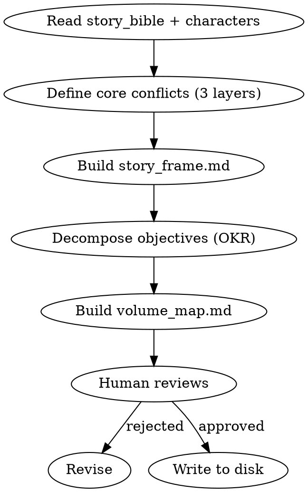

<!-- AUTO-CHECK-START -->

## auto-check (generated -- do not edit)

<!-- AUTO-CHECK-END -->

<!-- AUTO-GENERATED from frontmatter — do not edit -->

## 数据契约

- **Reads:** novel.json, genesis-context/three_act.md, genesis-context/plot_lines.md, genesis-context/surface_conflict.md, genesis-context/personal_conflict.md, genesis-context/deep_conflict.md, world/story_bible.md, characters/**/*.md, genre-config.json
- **Writes:** outline/story_frame.md, outline/volume_map.md, outline/rhythm_principles.md
- **Updates:** none

<!-- END AUTO-GENERATED -->

# 故事架构

**Seed 片段（genesis-context/）**：`genesis-context/three_act.md`、`genesis-context/plot_lines.md` 与三个冲突片段（`genesis-context/surface_conflict.md`/`genesis-context/personal_conflict.md`/`genesis-context/deep_conflict.md`）是人类伙伴 seed 原文的逐字片段（人类原始意向输入）。权威序：上游已产出 truth > seed 片段；冲突时以上游为准，若据此调整须在本技能产出文件内以「seed 意向与 truth 冲突的处理记录」小节披露（含一句理由）。

HARD-GATE: 故事框架必须在世界观和角色完成后才能开始。
**章数基线（硬约束）**：`genre-config.json` 的 `chapter_word.default` 是章数数学唯一基线——总章数 = target_word_count ÷ default 向上取整。`outline/volume_map.md` 与 `outline/rhythm_principles.md` 的 frontmatter **必须**含 `total_chapters: <N>` 行（N 按上述数学推导），genesis-complete 的五方对账 gate 会核对该行；缺失该行会被显式报为对账盲区（probe2 2026-10-01：本技能曾因读不到 genre-config 而独立推导出 135 章，与基线 67 章失配，靠对账 gate 拦截后才人工重对齐）。

**职责边界**：本 skill 创建 `outline/story_frame.md`、`outline/volume_map.md`、`outline/rhythm_principles.md` 的**骨架**（整体哲学 + 比例粗设 + 卷划分）。后续细化由专项 skill 负责——`outline/rhythm_principles.md` 详化为完整节奏规则见 `shenbi-pacing-design`；`outline/volume_map.md` 单卷细化见 `shenbi-volume-outlining`。

## 流程



## 铁律

1. **双线必写** — story_frame.md 必须包含前台故事（读者每章看到的表面冲突）和后台故事（贯穿全书的暗线）
2. **OKR 递归分解** — 全书 Objective → 每卷 Key Results → planner 据此分解章节任务
3. **核心冲突三层** — surface（表面矛盾）、personal（主角个人困境）、deep（主题层面的终极问题）
4. **散文骨架** — 输出散文段落，不是条目列表
5. **章数预算硬约束** — 全书章数与卷数由 `novel.json` 的 `target_word_count` 预算决定，不得自由发挥：`总章数 = ceil(target_word_count ÷ 每章目标字数)`（每章字数**必须**取 `genre-config.json` 的 `chapter_word.default`——该文件已在本技能 reads 中；**不设数值缺省**，读不到该文件即属派发配置错误，停下报告而不是自造默认。probe2 2026-10-01：旧版「缺省 1000-1500」+ reads 缺文件 → 独立推导 135 章，与基线 67 失配，靠对账 gate 拦截），`卷数 = clamp(round(总章数 ÷ 每卷章数), 1, 5)`（每卷章数按总章数均分，总章数不足一卷时强制单卷）。短篇/金丝雀种子（如 3000 字）= 3 章单卷，禁止套用长篇多卷模板。volume_map.md 的卷划分骨架与最大章界必须落在此预算内，且 frontmatter 必须写 `total_chapters: <N>`（N=本铁律推导值；框架按 volume_map 最大章界回写 `total_chapters`，五方对账 gate 核对该行）。

## 核心冲突三层

| 层级 | 说明 | 示例（玄幻） |
|------|------|-------------|
| Surface | 推动情节的外部矛盾 | 门派选拔赛、资源争夺 |
| Personal | 主角内心的困境 | 身份认同、信任背叛 |
| Deep | 全书探讨的主题问题 | 力量与自由的代价 |

## 输出格式

| 文件 | 内容 |
|------|------|
| `outline/story_frame.md` | 散文骨架（4段），YAML frontmatter 含三层冲突定义 |
| `outline/volume_map.md` | 分卷地图，每卷含 objective + key results |
| `outline/rhythm_principles.md` | **节奏骨架**（仅含整体节奏哲学 + 章节类型比例粗设）。详细的张力曲线规则、连续章数限制、间隔控制由 `shenbi-pacing-design` skill 细化。story-architecture 创建骨架，pacing-design 负责细化。 |

### story_frame.md 结构

> genre/core_concept/themes 已在 `novel.json` 定义，此处不重复。story_frame.md 只存储 story-architecture 特有的冲突定义。

```markdown
---
surface_conflict: "外部矛盾"
personal_conflict: "主角困境"
deep_conflict: "主题问题"
---

# 故事框架

## 段1：前台故事
[读者从第1章开始看到的表面线索，以散文叙述]

## 段2：后台故事
[贯穿全书的暗线，不在第1章暴露，以散文叙述]

## 段3：主角旅程
[从起点到终点的弧线概述]

## 段4：暗流伏笔种子
[为后续伏笔系统提供的种子方向]
```

### volume_map.md 结构

```markdown
# 分卷地图

## 第一卷：卷名

**Objective**: 本卷核心目标

**Key Results**:
1. KR1（第1-5章完成）
   - 第1章节点: [本章在KR1中的具体定位——开篇、承接、转折或收官]
   - 第2章节点: ...
   - ...
2. KR2（第6-10章完成）
   - 第6章节点: ...
   - ...
3. KR3（第11-15章完成）
   - ...

**节奏原则**: 本卷的张力曲线描述

**跨卷衔接**: 本卷结尾如何过渡到下一卷
```

每个 KR 下的章节节点是 `chapter-planning` DOT 流程图中 "Locate outline node for this chapter" 的锚点。规划器据此推导单章目标。

## Anti-Rationalization

| Excuse | Reality |
|--------|---------|
| "先写第一章再说大纲" | 没有框架的第一章 = 写到10章必定偏航 |
| "网文不需要这么复杂的结构" | 读者看不出来 ≠ 读者感觉不到。好的结构是"不知不觉被吸引" |
| "大纲会限制 spontaneity" | 大纲是轨道，不是牢笼。轨道让速度有意义 |
| "卷纲太细了，后面会改的" | 改大纲的代价 << 改50章正文的代价 |
| "小种子也按标准五卷史诗规划显得专业" | 3000 字种子规划 120 章 = chapter loop 按错误目标跑、逐章派发全部爆量。预算是硬约束不是建议 |


## 年代锚纪律

绝对年数（「X 年/年前」「N 年来」形态，含阿拉伯数字）只登记于 `world/story_bible.md` 的「世界史时间线」表。本 skill 的输出涉及年代时只写**锚名**或相对表述（如「净场之后」「旧历末年」），不写裸年数——G4.ys 机械扫描会把裸年数判为不合格（probe15：四层年数互斥耗掉四轮创世裁决）。
